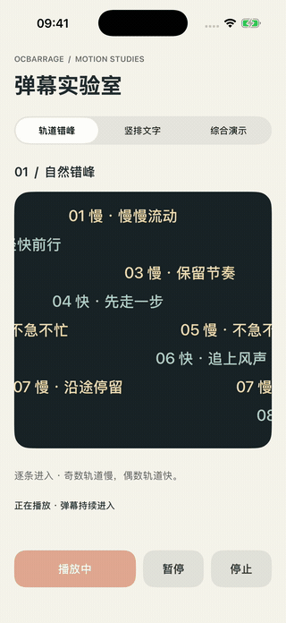
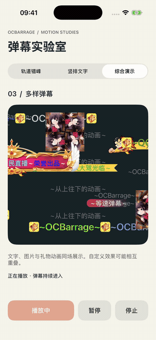
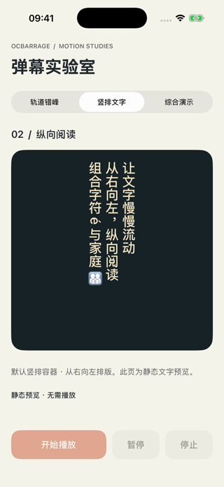
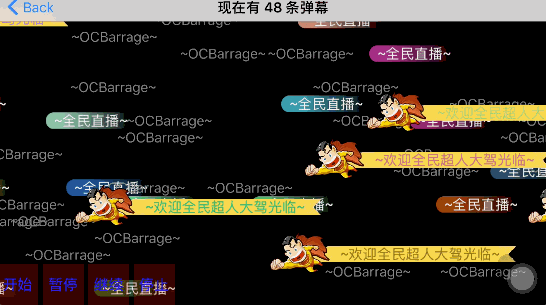
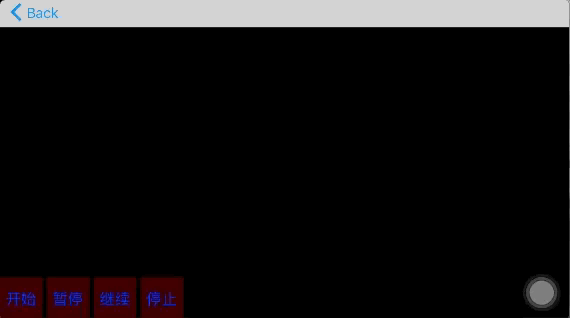

# OCBarrage

基于 Swift 6、Core Animation 和 Core Graphics 的 iOS 弹幕渲染库，支持文字、图文、GIF 和自定义路径动画。通过描述符配置内容，由渲染器负责布局、动画和 cell 复用。

An extensible iOS barrage renderer with reusable cells and custom Core Animation effects. The demo includes staggered lane playback, vertical text layout, and mixed effects.

## 效果预览

<table>
  <tr>
    <th>轨道错峰 · 奇慢偶快</th>
    <th>综合演示 · 图文与 GIF</th>
    <th>竖排文字 · 静态预览</th>
  </tr>
  <tr>
    <td></td>
    <td></td>
    <td></td>
  </tr>
</table>

上方预览保留迁移前的同版界面记录；Swift 迁移已另行完成模拟器交互和录屏验收。动态预览来自 iPhone 17 Pro / iOS 26.5 模拟器真实录屏，按原速截取 8 秒，压缩为 12 fps GIF；竖排预览取自同一模拟器录屏的静态帧。三张预览统一保留顶部状态栏（09:41、满格 Wi-Fi、满电），标题、画布与底部按钮位置一致。GIF 用于展示行为，不能代表 App 的实际帧率。轨道动图展示持续播放阶段，点击开始时仍只发送第一条。

## 功能一览

| 能力 | 说明 |
| --- | --- |
| 文字弹幕 | 字体、颜色、描边、阴影、固定速度或指定时长 |
| 轨道调度 | 范围约束、错峰入场、标准水平动画的速度约束 |
| 图文与 GIF | 通过自定义 cell 接入 YYKit，支持独立动画视图 |
| 自定义效果 | 渐变背景、走动横幅、礼物停留、竖向移动 |
| 交互与生命周期 | 点击回调、暂停、继续、停止、cell 复用 |
| 竖排排版 | Demo 内置 YYKit 示例，从右向左排列文字列 |

## 运行 Demo

打开 `OCBarrage.xcodeproj`，选择 **OCBarrage** scheme 和 iOS 模拟器运行。启动后直接进入“弹幕实验室”，无需先点中转页面。工程内已包含 Demo 使用的 YYKit 源码，不需要先安装 Pods。

| 模式 | 展示内容 | 播放方式 |
| --- | --- | --- |
| 轨道错峰 | 各轨道逐条入场，奇数轨道慢、偶数轨道快 | 点击“开始播放” |
| 竖排文字 | 默认竖排容器，从右向左排列各列，包含组合字符和 emoji | 静态预览，播放按钮禁用 |
| 综合演示 | 文字、图文、GIF、礼物和自定义动画 | 点击“开始播放”；不同效果可能重叠 |

### 奇偶轨道速度与逐条入场

轨道按**实际画面从上往下**编号，从 **1** 开始：

| 轨道 | 移动速度 | 标识与颜色 |
| --- | --- | --- |
| 第 1、3、5、7 条 | **60 pt/s** | “01 慢”等，暖黄色 |
| 第 2、4、6、8 条 | **110 pt/s** | “02 快”等，浅绿色 |

- 点击开始时只发送第 1 条弹幕，之后每隔约 **0.65 秒**向下一条轨道发送一条，轮到最后一条后回到第 1 条。不会一次性把全部轨道填满。
- 每条轨道占用 **40 pt** 高的行带，按画布高度显示，最多 8 条；轨道位置使用 `renderRange` 固定，速度不会因为渲染器随机选行而交换。
- 使用固定移动速度，文字长短只影响完整通过画布所需的时间，不改变 pt/s。
- 0.65 秒是 Demo 的**发送间隔**。渲染器仍会加入短暂入场延迟，并在同类相交轨道繁忙时排队，因此不是保证每条都在该时刻进入可见区域。

以上是 [Demo 的配置](OCBarrage/ViewController.swift)，不是库对所有调用方强制采用的策略。

### 综合模式与 GIF

综合模式将约一秒拆成七个发送时隙，每次最多准备一种效果，减少同一回调中的集中绘制。普通文字、渐变文字、竖向移动约每秒发送一次；图文、横幅、GIF、礼物分别约每 2、3、4、5 秒发送一次。繁忙时仍受 Demo 的活动 cell 数量限制，并非严格的实时调度。

固定 PNG 和 GIF 资源在页面内复用，每条弹幕持有独立的动画 view。GIF 按需解码动画帧，不预加载全部帧。

### 播放控制

| 操作 | 行为 |
| --- | --- |
| 开始播放 | 立即发送第一条；播放时按钮禁用，防止重复创建发送任务 |
| 暂停 | 冻结弹幕位移动画，取消后续发送，保留当前发送序列；GIF 等自定义内容的内部动画需自行管理 |
| 继续播放 | 从暂停位置继续；不立即补发整批弹幕，下一次发送延续原轨道序列 |
| 停止 | 清空弹幕、取消发送，并将发送序列复位；再次开始从第 1 条轨道开始 |
| 切换模式 | 先停止并清空旧模式；切到动态模式后需重新点击开始 |
| 离开页面／进入后台 | 离开页面停止；应用进入非活跃状态时暂停，回来后手动继续 |

播放按钮固定在底部安全区域，内容区支持滚动。竖排模式展示的是**文字排版方向**，与综合模式中“从上往下移动”的动画是两种不同效果。

### 构建要求与测试

核心包、Demo 和测试均为 Swift，最低 iOS 15；使用 Swift 6 语言模式和 Swift 6.2+ 工具链（隔离析构需要该编译器版本）。本次验证环境为 Xcode 27.2、Swift 6.4.2、iPhone 17 Pro / iOS 26.5 模拟器。工程内已配置部署版本，无需命令行覆盖。

```sh
export DEVELOPER_DIR=/Applications/Xcode.app/Contents/Developer
xcrun simctl list devices available
xcodebuild -project OCBarrage.xcodeproj -scheme OCBarrage \
  -destination 'platform=iOS Simulator,id=YOUR_SIMULATOR_UDID' build
xcodebuild -project OCBarrage.xcodeproj -scheme OCBarrage \
  -destination 'platform=iOS Simulator,id=YOUR_SIMULATOR_UDID' \
  -only-testing:OCBarrageTests -only-testing:OCBarrageUITests test
```

模拟器无需签名；真机运行需配置自己的开发团队和签名。

## 安装到自己的项目

### Swift Package Manager

在 Xcode 中添加本地克隆目录作为 Local Package，并选择 **OCBarrage** library。`Package.swift` 只包含 `OCBarrage/OCBarrage/*.swift` 核心实现，依赖 UIKit，不含 Demo、YYKit 或图片资源。当前 Swift 迁移版本尚未发布 tag，不能按已发布的 2.0.0 版本解析依赖。

```swift
import OCBarrage
```

也可以将核心目录的 Swift 文件直接加入 iOS target；直接添加文件时不需要 `import OCBarrage`。图文、GIF、竖排示例在 `OtherDescriptorAndCells/DemoCells.swift`，使用它们时还需要 YYKit、桥接头和对应资源。

### CocoaPods

仓库 podspec 的 `2.0.0` 是**待发布定义**，尚未创建 tag、发布 Pod 或执行远程 Pod 安装验收。需要当前本地代码可使用：

```ruby
pod 'OCBarrage', :path => '../OCBarrage'
```

已有公开版本仍是 Objective-C API，普通 `pod 'OCBarrage'` 不代表获得本次 Swift 迁移内容。

## 快速接入

UI API 由 `@MainActor` 隔离。控制器持有 manager，设置有效容器大小后启动和发送：

```swift
import UIKit
import OCBarrage

final class PlayerViewController: UIViewController {
    private let barrageManager = OCBarrageManager()

    override func viewDidLoad() {
        super.viewDidLoad()
        barrageManager.renderView.frame = CGRect(x: 0, y: 100, width: 320, height: 240)
        view.addSubview(barrageManager.renderView)
        barrageManager.start()

        let text = OCBarrageTextDescriptor()
        text.text = "你好，OCBarrage"
        text.textFont = .systemFont(ofSize: 20)
        text.textColor = .white
        text.animationDuration = 6
        text.barrageCellClass = OCBarrageTextCell.self
        barrageManager.renderBarrageDescriptor(text)
    }
}
```

尺寸变化时更新 `renderView.frame`。暂停、继续、停止分别调用 `pause()`、`resume()`、`stop()`。库管理弹幕动画，业务定时发送任务仍由调用方取消；manager 释放时会停止并清空渲染器。

### 配置速度与固定轨道

标准 `OCBarrageTextCell` 的 `animationDuration` 控制完整动画时长；`fixedSpeed > 0` 时优先使用固定速度，且最大值被限制为 100。实际速度（pt/s）= `UIScreen.main.scale × 2 × fixedSpeed`。例如固定第 2 条 40 pt 高的行带，速度为 110 pt/s：

```swift
text.renderRange = NSRange(location: 40, length: 80)
text.fixedSpeed = 110 / (UIScreen.main.scale * 2)
```

**历史 `renderRange` 语义保留：location 是 Y 下界，length 是 Y 上界。** 上例表示 `[40, 80]`，不是 `[40, 120]`；`NSRange(location: 0, length: 0)` 表示默认范围。行带必须容纳整个 cell。

### 点击回调

```swift
text.cellTouchedAction = { [weak barrageManager] descriptor, cell in
    cell.alpha = 0.8
    barrageManager?.pause()
}
```

回调在主 actor 上同步执行，支持暂停、停止、发送重入。优先使用带 cell 的 `cellTouchedAction`；兼容保留 `touchAction`。回调会被描述符持有，捕获 manager 或控制器时使用弱引用，避免业务闭包形成引用环。

### GIF 和自定义弹幕

GIF 是 Demo 扩展，不属于核心库。加入 `DemoCells.swift`、YYKit 与资源后，用 `OCBarrageGifDescriptor.image` 传入缓存的 `YYImage`，设置 `barrageCellClass = OCBarrageGifCell.self` 后发送。每条弹幕使用独立 `YYAnimatedImageView`；图片资源可以共享。manager 暂停只冻结位移，GIF 内部换帧由自定义 cell 管理。

1. 继承 `OCBarrageDescriptor` 或 `OCBarrageTextDescriptor` 增加数据，必要时实现 `public required init()`。
2. 继承 `OCBarrageCell` 或 `OCBarrageTextCell`，以 `barrageDescriptor as? CustomDescriptor` 读取数据。
3. 重写 `updateSubviewsData()`、`layoutContentSubviews()`、`convertContentToImage()`；动态视图可跳过栅格化并保留子视图。
4. 重写 `addBarrageAnimation(delegate:)` 实现自定义运动，设置动画代理并以 `kBarrageAnimation` 为 key 添加动画。
5. 重写 `prepareForReuse()` 时调用 `super`，释放自定义内容与回调。

核心可扩展类和生命周期方法为 `open`，动态 cell 构造使用 `OCBarrageCell.Type` 和 `required init()`；不能传入任意类。详见 [Swift 迁移说明](docs/Swift迁移.md)。

<details>
<summary>历史效果图：横幅、图文与礼物</summary>

这些动图展示原始扩展示例，与当前“弹幕实验室”的布局不同。

| 走动横幅 | 图文混排 | 礼物停留 |
| --- | --- | --- |
|  |  |  |

[查看历史综合效果](OCBarrage/Demonstration/demonstration.gif)

</details>

## 性能优化

- **资源复用**：Demo 的固定 PNG/GIF 只在首次使用时读取和初始化，后续发送复用同一份资源。
- **标签复用**：文字 cell 保留离屏 UILabel，复用时重挂并重置阴影；布局使用已经设置的富文本，减少重复创建和复制。
- **错峰准备**：综合模式每次最多准备一种效果，将原先同一回调内的集中工作分散执行。

迁移前 Objective-C 基线在同一模拟器、Debug 配置下，固定执行 30 轮“GIF＋图文准备”，每轮停止再开始，包含首次资源加载：

| 指标 | 优化前 | 优化后 |
| --- | ---: | ---: |
| 30 轮准备总耗时 | 234.723 ms | 21.094 ms |

以上是迁移前测试记录的准备代码墙钟耗时，不是平均帧率或掉帧率；随机颜色、系统负载和调度均会影响结果。首次加载仍是同步执行，GIF 后续帧仍按需解码，不能据此宣称所有场景无卡顿。

## 修复与验证范围

当前代码包含：

- 修复停止再启动后的闲置清理、复用外观残留，以及点击回调重入导致的锁等待。
- 修复非法尺寸、旧轨道索引、范围／行高变化及容器坐标问题。
- 标准水平线性动画支持错峰和同类相交轨道的速度约束；暂停／继续同步调度时间，复用重置图层时钟。
- 修复 Demo 内置 YYKit 的比较表达式和默认竖排容器布局，安全处理空文本及无效栅格化尺寸。

迁移前基线已通过 25 项单元测试和 1 项 UI 测试；Swift 迁移已通过 **27 项单元测试和 1 项 UI 测试**，逐项保留原用例，并补充释放与自然动画完成测试；独立 SPM 调用方构建也已通过。迁移验证结果见 [Swift 迁移说明](docs/Swift迁移.md)。覆盖轨道位置与快慢速度、逐条发送、生命周期、复用、点击重入、默认竖排，Demo 的真实触控操作与模式切换、标签及 GIF 资源复用、综合模式单次发送数量；另包含固定负载耗时记录。

边界：

- 不同 cell 类之间、自定义路径／非线性／竖向动画之间不保证无重叠；不能把 Demo 的快慢规则推广到所有自定义动画。
- 繁忙轨道可能排队，未新增通用容量控制或丢弃策略。
- 未完成真机帧率、全尺寸、旧 iOS 实机兼容性或大规模压力测试。历史“5000 条弹幕”描述不是本次实测结论。

## 文档与许可证

- 历史设计文章：[iOS 弹幕库 OCBarrage](https://www.jianshu.com/p/6593778a85e4)
- [MIT License](LICENSE)
- 原项目交流群：263384911
