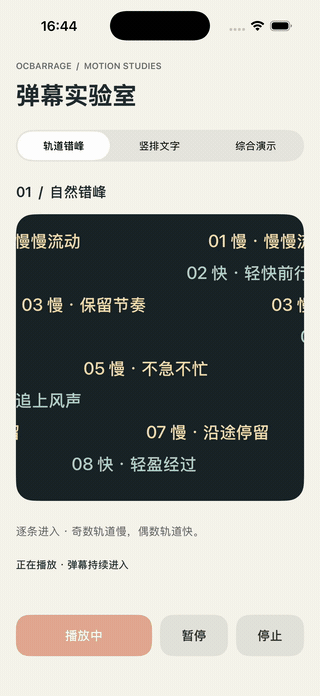
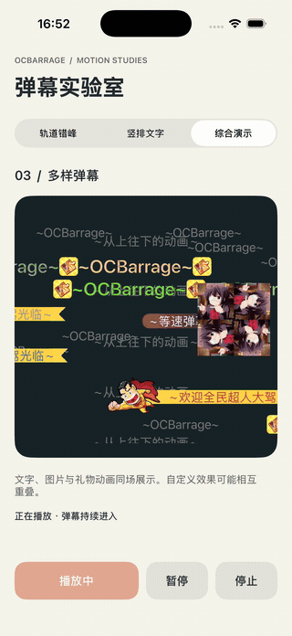
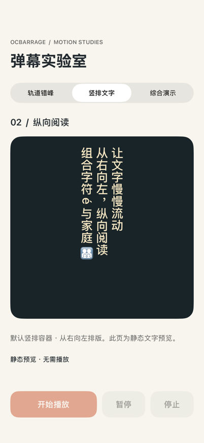
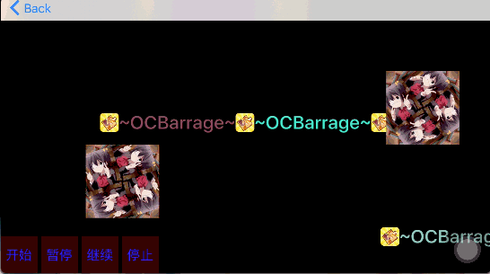

# OCBarrage

基于 Objective-C、Core Animation 和 Core Graphics 的 iOS 弹幕渲染库，支持文字、图文、GIF 和自定义路径动画。通过描述符配置内容，由渲染器负责布局、动画和 cell 复用。

An extensible iOS barrage renderer with reusable cells and custom Core Animation effects. The demo includes staggered lane playback, vertical text layout, and mixed effects.

## 效果预览

<table>
  <tr>
    <th>轨道错峰 · 奇慢偶快</th>
    <th>综合演示 · 图文与 GIF</th>
    <th>竖排文字 · 静态预览</th>
  </tr>
  <tr>
    <td></td>
    <td></td>
    <td></td>
  </tr>
</table>

动态预览来自 iPhone 17 Pro / iOS 26.5 模拟器真实录屏，按原速截取 8 秒，压缩为 12 fps GIF；竖排预览来自 UI 验证截图。GIF 用于展示行为，不能代表 App 的实际帧率。轨道动图展示持续播放阶段，点击开始时仍只发送第一条。

## 功能一览

| 能力 | 说明 |
| --- | --- |
| 文字弹幕 | 字体、颜色、描边、阴影、固定速度或指定时长 |
| 轨道调度 | 范围约束、错峰入场、标准水平动画的速度约束 |
| 图文与 GIF | 通过自定义 cell 接入 YYKit，支持独立动画视图 |
| 自定义效果 | 渐变背景、走动横幅、礼物停留、竖向移动 |
| 交互与生命周期 | 点击回调、暂停、继续、停止、cell 复用 |
| 竖排排版 | Demo 内置 YYKit 示例，从右向左排列文字列 |

## 运行 Demo

打开 `OCBarrage.xcodeproj`，选择 **OCBarrage** scheme 和 iOS 模拟器运行。启动后直接进入“弹幕实验室”，无需先点中转页面。工程内已包含 Demo 使用的 YYKit 源码，不需要先安装 Pods。

| 模式 | 展示内容 | 播放方式 |
| --- | --- | --- |
| 轨道错峰 | 各轨道逐条入场，奇数轨道慢、偶数轨道快 | 点击“开始播放” |
| 竖排文字 | 默认竖排容器，从右向左排列各列，包含组合字符和 emoji | 静态预览，播放按钮禁用 |
| 综合演示 | 文字、图文、GIF、礼物和自定义动画 | 点击“开始播放”；不同效果可能重叠 |

### 奇偶轨道速度与逐条入场

轨道按**实际画面从上往下**编号，从 **1** 开始：

| 轨道 | 移动速度 | 标识与颜色 |
| --- | --- | --- |
| 第 1、3、5、7 条 | **60 pt/s** | “01 慢”等，暖黄色 |
| 第 2、4、6、8 条 | **110 pt/s** | “02 快”等，浅绿色 |

- 点击开始时只发送第 1 条弹幕，之后每隔约 **0.65 秒**向下一条轨道发送一条，轮到最后一条后回到第 1 条。不会一次性把全部轨道填满。
- 每条轨道占用 **40 pt** 高的行带，按画布高度显示，最多 8 条；轨道位置使用 `renderRange` 固定，速度不会因为渲染器随机选行而交换。
- 使用固定移动速度，文字长短只影响完整通过画布所需的时间，不改变 pt/s。
- 0.65 秒是 Demo 的**发送间隔**。渲染器仍会加入短暂入场延迟，并在同类相交轨道繁忙时排队，因此不是保证每条都在该时刻进入可见区域。

以上是 [Demo 的配置](OCBarrage/ViewController.m)，不是库对所有调用方强制采用的策略。

### 综合模式与 GIF

综合模式将约一秒拆成七个发送时隙，每次最多准备一种效果，减少同一回调中的集中绘制。普通文字、渐变文字、竖向移动约每秒发送一次；图文、横幅、GIF、礼物分别约每 2、3、4、5 秒发送一次。繁忙时仍受 Demo 的活动 cell 数量限制，并非严格的实时调度。

固定 PNG 和 GIF 资源在页面内复用，每条弹幕持有独立的动画 view。GIF 按需解码动画帧，不预加载全部帧。

### 播放控制

| 操作 | 行为 |
| --- | --- |
| 开始播放 | 立即发送第一条；播放时按钮禁用，防止重复创建发送任务 |
| 暂停 | 冻结弹幕位移动画，取消后续发送，保留当前发送序列；GIF 等自定义内容的内部动画需自行管理 |
| 继续播放 | 从暂停位置继续；不立即补发整批弹幕，下一次发送延续原轨道序列 |
| 停止 | 清空弹幕、取消发送，并将发送序列复位；再次开始从第 1 条轨道开始 |
| 切换模式 | 先停止并清空旧模式；切到动态模式后需重新点击开始 |
| 离开页面／进入后台 | 离开页面停止；应用进入非活跃状态时暂停，回来后手动继续 |

播放按钮固定在底部安全区域，内容区支持滚动。竖排模式展示的是**文字排版方向**，与综合模式中“从上往下移动”的动画是两种不同效果。

### 新版 Xcode 运行与测试

项目及 podspec 保留 `iOS 8.0` 部署声明，但本次验证使用 **Xcode 27.2、iPhone 17 Pro / iOS 26.5**。该工具链不支持原 iOS 8 部署目标，需要在本次模拟器构建时覆盖最低版本；这不代表已验证旧系统兼容性。

在仓库根目录执行以下命令，替换为本机可用模拟器的 UDID：

```sh
# 若 Xcode 不在此路径，请调整；仅影响当前终端会话。
export DEVELOPER_DIR=/Applications/Xcode.app/Contents/Developer
xcrun simctl list devices available

xcodebuild -project OCBarrage.xcodeproj -scheme OCBarrage \
  -destination 'platform=iOS Simulator,id=YOUR_SIMULATOR_UDID' \
  IPHONEOS_DEPLOYMENT_TARGET=15.0 CODE_SIGNING_ALLOWED=NO build

xcodebuild -project OCBarrage.xcodeproj -scheme OCBarrage \
  -destination 'platform=iOS Simulator,id=YOUR_SIMULATOR_UDID' \
  -only-testing:OCBarrageTests -only-testing:OCBarrageUITests \
  IPHONEOS_DEPLOYMENT_TARGET=15.0 CODE_SIGNING_ALLOWED=NO test
```

在 Xcode 界面中运行时，也需为相应构建配置设置当前工具链支持的 Deployment Target。签名关闭参数仅用于这里的模拟器验证，不适用于真机发布。

## 安装到自己的项目

### 使用当前仓库源码

将 [`OCBarrage/OCBarrage`](OCBarrage/OCBarrage) 中的 `.h`、`.m` 文件加入项目，启用 ARC，并导入：

```objc
#import "OCBarrage.h"
```

核心库与 Demo 分离：`OtherDescriptorAndCells` 中的扩展示例、图片资源以及内置 YYKit 不属于核心库。使用图文、GIF、竖排示例时，需要一并集成相应实现及依赖。

### CocoaPods

```ruby
pod 'OCBarrage'
```

执行 `pod install` 后导入 `OCBarrage.h`。**发布版本与当前仓库修改需区分**：仓库 podspec 仍为 `1.0.5`，本轮修改未发布新的 Pod 版本；普通安装不能据此认为已经包含本轮修复。需要当前代码时可先将仓库克隆到本地，再使用路径依赖：

```ruby
pod 'OCBarrage', :path => '../OCBarrage'
```

## 快速接入

在主线程创建并持有 manager，先给渲染视图设置有效大小，再发送弹幕：

```objc
// 控制器属性，保持 manager 的生命周期。
@property (nonatomic, strong) OCBarrageManager *barrageManager;

// 视图初始化时：
self.barrageManager = [[OCBarrageManager alloc] init];
self.barrageManager.renderView.frame = CGRectMake(0, 100, 320, 240);
[self.view addSubview:self.barrageManager.renderView];
[self.barrageManager start];

OCBarrageTextDescriptor *text = [[OCBarrageTextDescriptor alloc] init];
text.text = @"你好，OCBarrage";
text.textFont = [UIFont systemFontOfSize:20];
text.textColor = [UIColor whiteColor];
text.animationDuration = 6;
text.barrageCellClass = [OCBarrageTextCell class];
[self.barrageManager renderBarrageDescriptor:text];
```

尺寸变化时更新 `renderView.frame`。暂停、继续、停止分别调用 manager 的 `pause`、`resume`、`stop`。如果业务侧有定时发送器，也必须同步暂停或取消：**库管理动画，不会替调用方取消自己的计时任务**。

### 配置速度与固定轨道

对于标准 `OCBarrageTextCell`：`animationDuration` 控制完整动画时长；`fixedSpeed > 0` 时优先使用固定速度，且最大值会被限制为 100。现有实现的换算为：

```text
实际移动速度（pt/s）= UIScreen.mainScreen.scale × 2 × fixedSpeed
```

例如将弹幕固定到第 2 条 40pt 高的行带，并设置 110 pt/s：

```objc
text.renderRange = NSMakeRange(40, 80);
text.fixedSpeed = 110.0 / (UIScreen.mainScreen.scale * 2.0);
```

**`renderRange` 是历史 API 的特殊约定：`location` 表示 Y 下界，`length` 表示 Y 上界，不是通常 NSRange 的区间长度。** 因此上例表示 `[40, 80]`，不是 `[40, 120]`。`NSMakeRange(0, 0)` 表示使用默认范围；行带必须能容纳整个 cell 的高度。

### 点击回调

```objc
text.cellTouchedAction = ^(OCBarrageDescriptor *descriptor, OCBarrageCell *cell) {
    NSLog(@"点击了弹幕：%@", cell);
};
```

使用 `cellTouchedAction`，旧 `touchAction` 已标记为弃用。回调在释放活动列表锁后同步执行，可以重入暂停或停止；业务回调仍应避免耗时操作。

### 接入 GIF 弹幕

GIF 是 Demo 的扩展示例，不包含在核心 Pod 的源码目录中。先加入 [`OCBarrageGifCell`](OCBarrage/OtherDescriptorAndCells/OCBarrageGifCell.m)、[`OCBarrageGifDescriptor`](OCBarrage/OtherDescriptorAndCells/OCBarrageGifDescriptor.h) 及 YYKit 依赖，并将 GIF 文件添加到应用资源中。

```objc
#import "OCBarrageGifCell.h"

// 控制器属性，避免每次发送都重新读取文件和初始化解码器。
@property (nonatomic, strong) YYImage *barrageGIF;

// manager 已启动、renderView 已设置有效尺寸，在主线程发送：
if (!self.barrageGIF) {
    NSString *path = [[NSBundle mainBundle] pathForResource:@"xuanzhuan" ofType:@"gif"];
    NSData *data = path ? [NSData dataWithContentsOfFile:path] : nil;
    if (data) self.barrageGIF = [YYImage imageWithData:data scale:4];
}
if (self.barrageGIF) {
    OCBarrageGifDescriptor *gif = [[OCBarrageGifDescriptor alloc] init];
    gif.image = self.barrageGIF;
    gif.animationDuration = 6;
    gif.barrageCellClass = [OCBarrageGifCell class];
    [self.barrageManager renderBarrageDescriptor:gif];
}
```

示例中的 `scale:4` 控制图片的显示尺寸，不控制播放速度。图片资源可以共享，`YYAnimatedImageView` 应由各 cell 独立持有。manager 的暂停只冻结弹幕位移；若还需要冻结 GIF 换帧，需在自定义 cell 中同步管理内部动画。

## 自定义弹幕

1. 继承 `OCBarrageDescriptor` 添加数据；文字类可继承 `OCBarrageTextDescriptor`。
2. 继承 `OCBarrageCell` 创建视图；需要复用文字能力时继承 `OCBarrageTextCell`。
3. 在 `setBarrageDescriptor:` 中调用 `super`，再保存自定义描述符。
4. 用 `updateSubviewsData` 更新内容，`layoutContentSubviews` 计算布局。
5. `convertContentToImage` 可将静态内容合成为图片；GIF 等动态内容可保留自己的子视图，并相应重写 `removeSubViewsAndSublayers`。
6. 需要自定义运动时重写 `addBarrageAnimationWithDelegate:`，正确设置动画代理和动画引用；在 `prepareForReuse` 中调用 `super` 并清理自定义状态。

示例见 [`OtherDescriptorAndCells`](OCBarrage/OtherDescriptorAndCells)。

<details>
<summary>历史效果图：横幅、图文与礼物</summary>

这些动图展示原始扩展示例，与当前“弹幕实验室”的布局不同。

| 走动横幅 | 图文混排 | 礼物停留 |
| --- | --- | --- |
|  |  |  |

[查看历史综合效果](OCBarrage/Demonstration/demonstration.gif)

</details>

## 性能优化

- **资源复用**：Demo 的固定 PNG/GIF 只在首次使用时读取和初始化，后续发送复用同一份资源。
- **标签复用**：文字 cell 保留离屏 UILabel，复用时重挂并重置阴影；布局使用已经设置的富文本，减少重复创建和复制。
- **错峰准备**：综合模式每次最多准备一种效果，将原先同一回调内的集中工作分散执行。

在同一模拟器、Debug 配置下，固定执行 30 轮“GIF＋图文准备”，每轮停止再开始，包含首次资源加载：

| 指标 | 优化前 | 优化后 |
| --- | ---: | ---: |
| 30 轮准备总耗时 | 234.723 ms | 21.094 ms |

以上是本次测试记录的准备代码墙钟耗时，不是平均帧率或掉帧率；随机颜色、系统负载和调度均会影响结果。首次加载仍是同步执行，GIF 后续帧仍按需解码，不能据此宣称所有场景无卡顿。

## 修复与验证范围

当前代码包含：

- 修复停止再启动后的闲置清理、复用外观残留，以及点击回调重入导致的锁等待。
- 修复非法尺寸、旧轨道索引、范围／行高变化及容器坐标问题。
- 标准水平线性动画支持错峰和同类相交轨道的速度约束；暂停／继续同步调度时间，复用重置图层时钟。
- 修复 Demo 内置 YYKit 的比较表达式和默认竖排容器布局，安全处理空文本及无效栅格化尺寸。

2026-11-14 在上述环境中执行 **25 项单元测试和 1 项 UI 测试，全部通过**。覆盖轨道位置与快慢速度、逐条发送、生命周期、复用、点击重入、默认竖排，Demo 的真实触控操作与模式切换、标签及 GIF 资源复用、综合模式单次发送数量；另包含固定负载耗时记录。

边界：

- 不同 cell 类之间、自定义路径／非线性／竖向动画之间不保证无重叠；不能把 Demo 的快慢规则推广到所有自定义动画。
- 繁忙轨道可能排队，未新增通用容量控制或丢弃策略。
- 未完成真机帧率、全尺寸、旧 iOS 实机兼容性或大规模压力测试。历史“5000 条弹幕”描述不是本次实测结论。

## 文档与许可证

- 历史设计文章：[iOS 弹幕库 OCBarrage](https://www.jianshu.com/p/6593778a85e4)
- [MIT License](LICENSE)
- 原项目交流群：263384911
